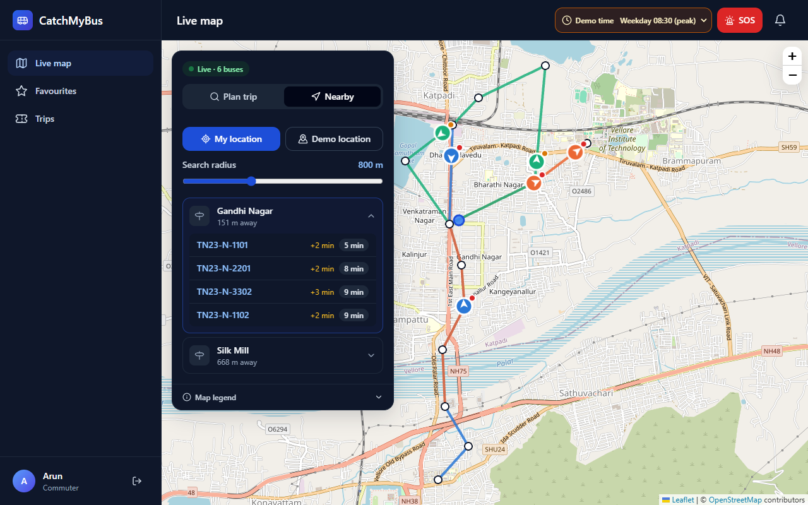
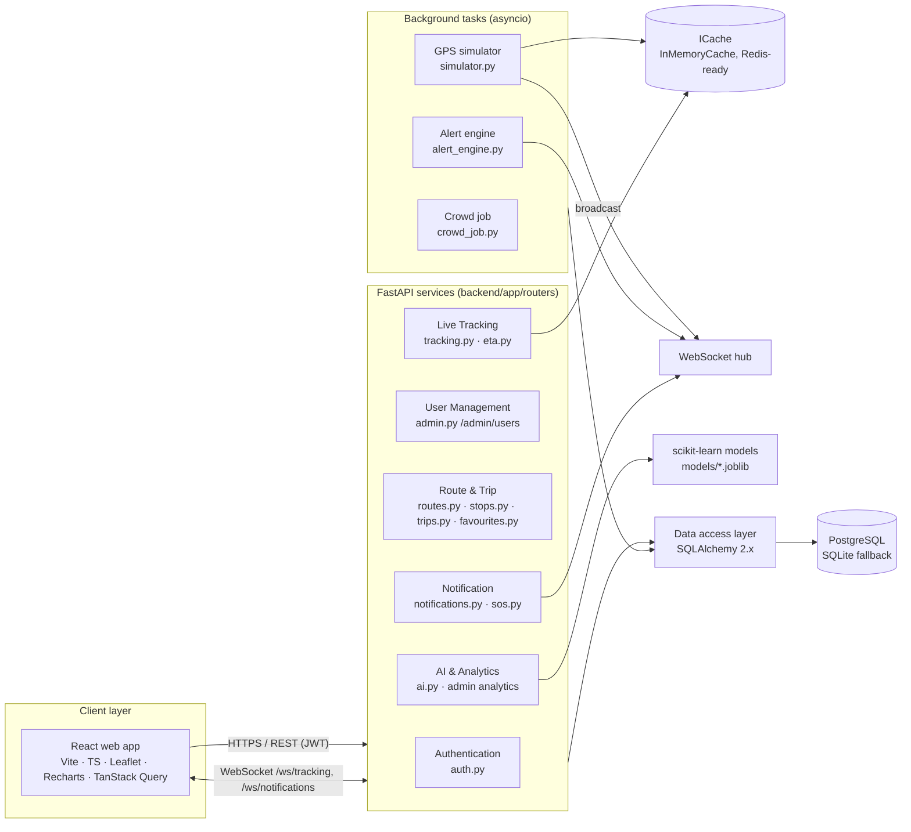
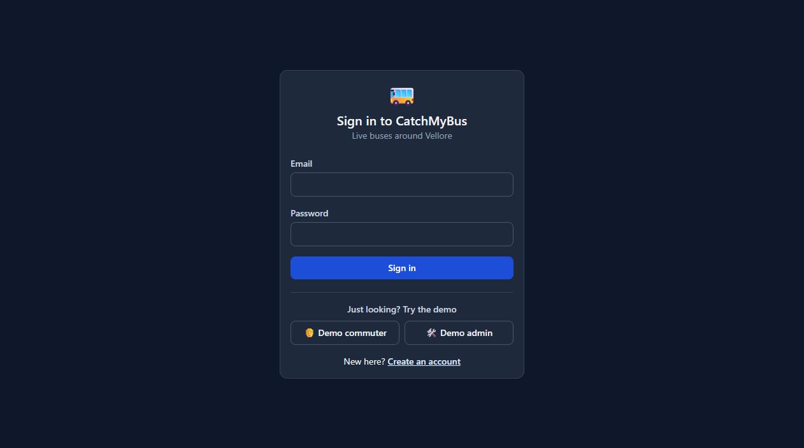

# CatchMyBus

An AI-powered public transport tracking and smart travel assistant for Vellore, built as a
Software Engineering lab project (VIT, BCSE301P).

Commuters see buses move live on a map, get ETAs that update every 2 seconds, set arrival
alerts and get warned about delays. The app also shows predicted crowd levels and suggests
the best route with the score explained. Admins manage the fleet and network (every change
is audited), post announcements, watch a live SOS feed, trigger delays for the demo and
read an analytics dashboard.

Everything runs locally with no API keys. Only the OpenStreetMap map tiles need internet.



## Contents

- [Architecture](#architecture)
- [Setup](#setup)
- [Demo credentials](#demo-credentials)
- [5-minute demo script](#5-minute-demo-script)
- [API summary](#api-summary)
- [AI module](#ai-module)
- [Testing and performance](#testing-and-performance)
- [Requirements traceability](#requirements-traceability)
- [Project structure](#project-structure)
- [Future scope](#future-scope)

## Architecture



Each service is its own router module plus service classes, so a new module plugs in with
one `include_router` line (NFR09). The latest bus positions live behind the `ICache`
interface ([backend/app/cache.py](backend/app/cache.py)), so a Redis implementation could
replace `InMemoryCache` without touching callers.

**How the live data flows:** the simulator moves each bus along its route polyline every
2 s. Each position goes to the cache and out over `/ws/tracking`, and history is stored
every 10 s. ETA and alert checks read positions from the cache. The alert engine runs
every 5 s, persists each notification and pushes it over `/ws/notifications`.

## Setup

### Option A: Docker (Postgres)

Needs Docker Desktop and `make`.

```bash
make up && make seed
```

- Web app: http://localhost:5173
- API docs (Swagger): http://localhost:8000/docs

`make up` copies `.env.example` to `.env` if it is missing, then starts Postgres, the API
and the Vite dev server. On first start the API trains the ML models (about 20 s) and seeds
itself if the database is empty. `make seed` resets the database to a clean demo state.

> Change `JWT_SECRET` and the passwords in `.env` before using this anywhere real.

### Option B: Local, no Docker (SQLite)

Needs Python 3.11+ and Node 20+.

```bash
cp .env.example .env
# in .env set:  DATABASE_URL=sqlite:///./catchmybus.db   and a random JWT_SECRET

cd backend
python -m venv .venv && .venv/Scripts/activate      # Linux/macOS: source .venv/bin/activate
pip install -r requirements-dev.txt
python -m app.ml.train        # generates synthetic data + trains models (make train)
python -m app.seed            # make seed
uvicorn app.main:app --port 8000

# second terminal
cd frontend && npm install && npm run dev
```

The simulator can also run on its own, without the API: `python -m app.simulator`.

### Make targets

| Target | What it does |
|---|---|
| `make up` / `make down` | Start or stop the docker-compose stack |
| `make seed` | Reset the database and load demo data from `backend/seed/*.json` |
| `make train` | Generate the synthetic dataset and train both models |
| `make test` | Run backend pytest and frontend Vitest |
| `make loadtest` | 60 s Locust run against `/eta`, `/buses` and more |
| `make backup` | Dump the database to `backups/`, keeping the newest 7 |

All configuration is in `.env` (see [.env.example](.env.example)). There are no secrets in
the source code.

## Demo credentials

| Role | Email | Password |
|---|---|---|
| Admin | `admin@catchmybus.com` | `Admin@123` |
| Commuter | `arun@mail.com` | `Arun@123` |

These are the defaults in `.env.example` (`SEED_ADMIN_PASSWORD`, `SEED_COMMUTER_PASSWORD`).
Both roles sign in through the same login form, and the server decides the role.

**One-click demo sign-in.** With `DEMO_LOGIN_ENABLED=true` (the default in `.env.example`),
the login page shows **Demo commuter** and **Demo admin** buttons, so no one has to type
credentials during a demo. The buttons call `POST /auth/demo-login`, which only signs in
the two seeded accounts. The frontend never contains a password. Set
`DEMO_LOGIN_ENABLED=false` for any real deployment, and the buttons disappear.



## 5-minute demo script

Open two browser windows side by side: **A** (normal) and **B** (private/incognito).

| Time | Step | What to show |
|---|---|---|
| 0:00 | **A:** click **Demo commuter** on the login page (or sign in as `arun@mail.com`). | Live map: six buses glide along three coloured routes around Katpadi and Vellore. |
| 0:30 | **A:** click **Use demo location** and open *Gandhi Nagar*. | Nearby stops within the radius, with live arrivals per bus. Click **Use my location** to show the privacy note and consent dialog first. |
| 1:00 | **A:** click a bus marker. | Bus page: crowd badge, live speed and load, predicted delay, and an ETA per stop that falls every few seconds as the bus approaches. |
| 1:30 | **A:** in the header, switch **Demo time** between *Weekday 08:30 (peak)* and *Weekday 14:00*. | The crowd badges change (more *High* at 08:30). The coloured dots on the map change too. |
| 2:00 | **A:** on the bus page, click **Set alert**, pick a stop about 6-8 min away and set 5 min. | When the ETA reaches 5 min, the bell count goes up and a toast appears. |
| 2:30 | **B:** click **Demo admin**, go to **Admin → Live ops**, choose the same bus, 15 min, **Inject delay**. | Within about 5 s, window **A** gets a *delay* toast. The bus stops on the map and its ETA jumps by about 15 min. |
| 3:15 | **A:** go back to the map, pick *Gandhi Nagar → Green Circle*, and click **Search routes**. | Best-route ranking with score bars (time, walking, crowding, delay risk). |
| 3:45 | **A:** press **SOS** and then **Send SOS**. | Success state in **A**. In **B** the SOS appears in the live feed and as a toast. Click **Mark resolved**. |
| 4:15 | **B:** go to **Fleet**, edit a bus's capacity, then open **Audit log**. | The edit shows with timestamp, admin id and the before/after change. Swagger also shows `/admin/*` returning **403** for a commuter token. |
| 4:40 | **B:** open **Analytics**. | Ridership by hour (clear 8-10 and 17-19 peaks), ridership and average delay by route, crowd distribution, and model metrics with the synthetic-data disclaimer. |

Screenshots of every step are in [docs/screenshots](docs/screenshots).

## API summary

All endpoints except `/health` and the `/auth/register`, `/auth/login` and `/auth/demo*` endpoints need
`Authorization: Bearer <JWT>`. `/admin/*` needs the ADMIN role and returns 403 for anyone
else. List endpoints accept `?page=&size=`. The AI endpoints read an optional
`X-Demo-Time` header: `08:30` means that time on a weekday, and `Sat 12:00` picks a day.
The full interactive spec is at `/docs`.

| Area | Endpoints |
|---|---|
| Auth | `POST /auth/register`, `POST /auth/login` (rate limited), `GET /auth/me`, `GET /auth/demo`, `POST /auth/demo-login` (only when `DEMO_LOGIN_ENABLED=true`) |
| Tracking | `GET /buses`, `GET /buses/live`, `GET /buses/{id}/location`, `WS /ws/tracking?token=`, `WS /ws/notifications?token=` |
| Routes & stops | `GET /routes`, `GET /routes/all/detail`, `GET /routes/{id}`, `GET /routes/search?source=&destination=`, `GET /stops`, `GET /stops/nearby?lat=&lon=&radius_m=` |
| ETA | `GET /eta?bus_id=&stop_id=`, `GET /eta/bus/{id}`, `GET /stops/{id}/arrivals` |
| Favourites | `GET/POST /favourites`, `DELETE /favourites/{id}` |
| Trips | `POST /trips/start`, `POST /trips/{id}/complete`, `GET /trips?date_from=&date_to=` |
| Alerts & inbox | `POST /alerts/subscribe`, `GET /alerts`, `DELETE /alerts/{id}`, `GET /notifications`, `GET /notifications/unread-count`, `POST /notifications/read-all` |
| SOS & news | `POST /sos`, `GET /announcements` |
| AI | `GET /ai/crowd?bus_id=`, `GET /ai/crowd/all`, `GET /ai/delay?bus_id=&stop_id=`, `GET /ai/best-route?source=&destination=[&w_eta=&w_walk=&w_crowd=&w_delay=]`, `GET /ai/metrics` |
| Admin | CRUD on `/admin/{buses,drivers,routes,stops,schedules}`, `/admin/route-stops`, `/admin/announcements`, `GET /admin/sos`, `POST /admin/sos/{id}/resolve`, `POST /admin/sim/delay`, `GET /admin/audit-log`, `GET /admin/analytics`, `GET /admin/users` |
| Ops | `GET /health` |

## AI module

> **Disclaimer:** the training data is **synthetic**. It is generated by
> [scripts/generate_data.py](scripts/generate_data.py) from hand-written patterns in
> [backend/app/ml/patterns.py](backend/app/ml/patterns.py), plus random noise. The models
> are for demonstration only and say nothing about real Vellore ridership.

**Dataset (50,000 rows).** Weekday peaks at 8-10 and 17-19, shoulder hours, a weekend dip,
different popularity per route (R2 > R1 > R3), rain in about 20% of rows (more passengers,
more traffic), a traffic factor, and 4% label noise.

**Crowd level (FR16).** `RandomForestClassifier(n_estimators=150, max_depth=12)`.
Features: `hour, day_of_week, route_id, stop_seq, is_peak, weather_factor`. Label:
LOW (<45% of capacity), MEDIUM (<80%), HIGH.

**Delay (FR18).** `GradientBoostingRegressor(n_estimators=200, max_depth=4)`. Features:
`hour, day_of_week, route_id, segment_distance, recent_speed, traffic_factor`. Target: delay
in minutes over the remaining distance.

**Metrics** on a held-out 20% test split (from `models/metrics.json`, also shown at
`GET /ai/metrics` and in the admin dashboard):

| Model | Metric | Value |
|---|---|---|
| Crowd | Accuracy | **0.829** |
| Crowd | F1 (LOW / MEDIUM / HIGH) | see `metrics.json` |
| Delay | MAE | **0.54 min** |
| Delay | R² | **0.946** |
| Delay | Baseline MAE (always predict the mean) | 2.32 min |

Crowd confusion matrix (rows are the true label, columns the prediction):

|  | LOW | MEDIUM | HIGH |
|---|---|---|---|
| **LOW** | 3946 | 436 | 33 |
| **MEDIUM** | 584 | 2333 | 254 |
| **HIGH** | 53 | 350 | 2011 |

Most errors are between neighbouring classes. LOW and HIGH are almost never confused.

**How the predictions are used.**

- **ETA (FR09).** ETA = remaining distance along the route ÷ smoothed recent speed (floor
  8 km/h) + any remaining incident hold + predicted delay for the distance still to go.
  The delay is proportional to the distance left, so the ETA reaches 0 on arrival. The
  confidence score falls with distance, slow speed and holds
  ([backend/app/services/eta.py](backend/app/services/eta.py)).
- **Best route (FR17).** Lower score is better:
  `score = w_eta × (wait + ride min) + w_walk × walk metres + w_crowd × crowd penalty (LOW 0, MED 1, HIGH 2.5) + w_delay × predicted delay`.
  The defaults are `1.0, 0.02, 4.0, 0.5`, set in `.env` or per request. The response
  returns every term, and the UI draws them as a stacked bar
  ([backend/app/ml/best_route.py](backend/app/ml/best_route.py)).
- **Fallback.** If the model files are missing, the predictor uses the hand-written
  patterns and labels its answers `"source": "heuristic"`.

## Testing and performance

- **Backend:** `cd backend && pytest` runs **67 tests**. They cover auth and bcrypt,
  rate limiting, 403 role guards on every admin endpoint, the ETA math, the nearby-stop
  radius, route search, alert thresholds and hysteresis, audit logging (including rollback
  on failure), SOS, analytics and the AI scoring.
- **Frontend:** `cd frontend && npm test` runs **6 Vitest tests**.
- The results are mapped to test IDs in [docs/TEST_REPORT.md](docs/TEST_REPORT.md).

**Load test (NFR01).** [scripts/locustfile.py](scripts/locustfile.py): 50 users, spawn rate
10/s, 60 s, local SQLite, simulator running, Windows laptop.

| Endpoint | Requests | Failures | p50 | p95 | p99 |
|---|---|---|---|---|---|
| `GET /eta` | 1005 | 0 | 8 ms | **20 ms** | 39 ms |
| `GET /buses` | 838 | 0 | 9 ms | **40 ms** | 53 ms |
| `GET /buses/live` | 746 | 0 | 7 ms | 19 ms | 34 ms |
| `GET /stops/nearby` | 267 | 0 | 9 ms | 22 ms | 38 ms |
| All requests | 2906 | 0 | 8 ms | 34 ms | 98 ms |

Both hot paths are well under the 500 ms p95 target.

## Requirements traceability

| Req | Description | Implemented in |
|---|---|---|
| FR01, FR02 | Register / login | [routers/auth.py](backend/app/routers/auth.py) · `POST /auth/register`, `/auth/login` · [Login.tsx](frontend/src/pages/Login.tsx) |
| FR28 | Role-based access | [security.py](backend/app/security.py) `require_admin` · `Protected admin` in [App.tsx](frontend/src/App.tsx) |
| FR06, FR10 | Live tracking on a map with route and stops | [simulator.py](backend/app/simulator.py), [routers/tracking.py](backend/app/routers/tracking.py) `WS /ws/tracking` · [LiveMap.tsx](frontend/src/components/LiveMap.tsx) |
| FR07 | Route search | [routers/stops.py](backend/app/routers/stops.py) `GET /routes/search` · [SearchBar.tsx](frontend/src/components/SearchBar.tsx) |
| FR08 | Nearby stops | `GET /stops/nearby` · [NearbyStops.tsx](frontend/src/components/NearbyStops.tsx) |
| FR09 | Live ETA | [services/eta.py](backend/app/services/eta.py), `GET /eta` · [BusDetail.tsx](frontend/src/pages/BusDetail.tsx) |
| FR11, FR12 | Favourite routes / stops | [routers/favourites.py](backend/app/routers/favourites.py) · [Favourites.tsx](frontend/src/pages/Favourites.tsx) |
| FR13, FR14 | Arrival and delay notifications | [services/alert_engine.py](backend/app/services/alert_engine.py), `POST /alerts/subscribe`, `WS /ws/notifications` · [NotificationBell.tsx](frontend/src/components/NotificationBell.tsx) |
| FR16 | Crowd prediction | [ml/predictor.py](backend/app/ml/predictor.py), `GET /ai/crowd` · [CrowdBadge.tsx](frontend/src/components/CrowdBadge.tsx) |
| FR17 | Best-route suggestion | [ml/best_route.py](backend/app/ml/best_route.py), `GET /ai/best-route` · [Search.tsx](frontend/src/pages/Search.tsx) |
| FR18 | Delay prediction | `GET /ai/delay` · bus page "Pred. delay" |
| FR22 | Trip history | [routers/trips.py](backend/app/routers/trips.py) · [Trips.tsx](frontend/src/pages/Trips.tsx) |
| FR25 | SOS alert | [routers/sos.py](backend/app/routers/sos.py) `POST /sos` · [SosButton.tsx](frontend/src/components/SosButton.tsx) · admin live SOS feed |
| FR29-FR31 | Admin CRUD: buses, drivers, routes, stops, schedules, announcements | [routers/admin.py](backend/app/routers/admin.py) · [Admin.tsx](frontend/src/pages/Admin.tsx) |
| FR33 | Analytics dashboard | [services/analytics.py](backend/app/services/analytics.py) `GET /admin/analytics` · [admin/Analytics.tsx](frontend/src/admin/Analytics.tsx) |
| NFR01 | p95 < 500 ms for /eta and /buses | [scripts/locustfile.py](scripts/locustfile.py), results above |
| NFR04 | Passwords hashed with bcrypt | [security.py](backend/app/security.py) (passlib bcrypt) · `test_register_creates_commuter_with_bcrypt_hash` |
| NFR07, NFR10 | Light/dark, responsive to phone width | Tailwind `dark:` (OS setting), mobile bottom-sheet panel · [screenshot](docs/screenshots/08-mobile-home.png) |
| NFR09 | Modular services | one router per service in [backend/app/routers](backend/app/routers), `ICache` interface |
| NFR12 | Daily DB backup | [scripts/backup.sh](scripts/backup.sh) (cron example inside) |
| NFR13 | Location consent and privacy note | consent modal in [NearbyStops.tsx](frontend/src/components/NearbyStops.tsx) |
| NFR14 | Audit log of admin changes | [services/audit.py](backend/app/services/audit.py), same-transaction write · `GET /admin/audit-log` |
| Security | CORS locked to the frontend origin; login rate limit; no hardcoded secrets | [main.py](backend/app/main.py) `FRONTEND_ORIGIN`, [ratelimit.py](backend/app/ratelimit.py), [.env.example](.env.example) |
| Ops | Health check and structured logs | `GET /health`, JSON logs from [logging_conf.py](backend/app/logging_conf.py) |

The design choices made where the spec was open are in [docs/DECISIONS.md](docs/DECISIONS.md).

## Project structure

```
backend/
  app/
    routers/      auth, tracking, routes, stops, eta, favourites, trips, notifications, sos, ai, admin
    services/     eta, alert_engine, notifications, hub (WebSocket), audit, analytics, route_geometry, crowd_job
    ml/           patterns (synthetic rules), predictor, train, best_route
    simulator.py  GPS simulator        cache.py  ICache + InMemoryCache
    models.py     SQLAlchemy tables    schemas.py  Pydantic v2
  seed/           stops.json, routes.json, fleet.json  (approximate Vellore data, editable)
  tests/          pytest suite
frontend/src/     pages/, components/, admin/, lib/, hooks/
scripts/          generate_data.py, locustfile.py, backup.sh
docs/             DECISIONS.md, TEST_REPORT.md, screenshots/
```

Seed coordinates for the stops (Katpadi Junction, Gandhi Nagar, Green Circle, CMC Hospital,
VIT Main Gate, …) are **approximate**. Edit `backend/seed/*.json` and run `make seed`.

## Future scope

These are deliberately out of scope for this version:

- Payments and digital bus passes
- Fare estimation
- Multi-language UI
- Voice search
- Seat reservation
- Offline mode
- Multi-modal journeys and transfers (best route is direct buses only)
- Smartwatch app
- Native mobile app
- Multi-region failover
- Auto-scaling

Other natural next steps are Redis as the `ICache` implementation, Alembic migrations, real
GPS feeds in place of the simulator, and retraining the models on real ridership data.
